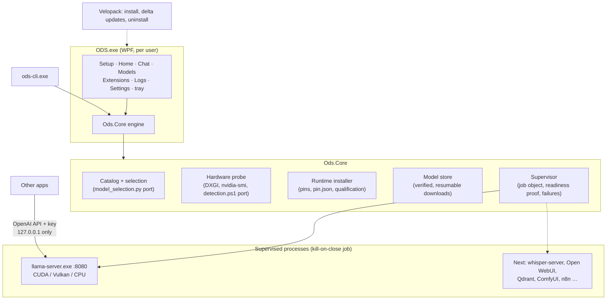

# Native Windows ODS: assessment and migration plan

Audience: ODS maintainers. Status: milestone 1 implemented in
[this repository](../README.md); later milestones proposed.

## Summary

ODS reaches Windows today through Ubuntu on WSL2 with Docker Desktop
([WINDOWS-QUICKSTART.md](https://github.com/Osmantic/ODS/blob/main/ods/docs/WINDOWS-QUICKSTART.md)). That works, but it asks a
Windows user to enable virtualization features, restart, create a Linux
account, install Docker Desktop (and accept its terms) and keep two operating
systems healthy. The goal of this plan is the bar Osmantic set: a user
installs ODS on a supported Windows PC, completes onboarding and uses its core
local AI without Docker, WSL or a hand-built environment, and the app handles
routine operation, failures, updates and removal predictably.

Milestone 1 meets that bar for ODS's core: hardware detection, the curated
model catalog and selection policy, llama.cpp inference, chat, the local
OpenAI-compatible API, model management, tray and sign-in behavior, logs and
a support bundle, and a per-user installer with delta updates and a clean
uninstall. Everything else moves service by service, each with a pinned,
verified Windows build or an embedded runtime, behind the same supervisor.

## Assessment of the current architecture

### Windows paths today

| Path | What it is | Docker/WSL? |
|---|---|---|
| `install.ps1` (supported) | Prepares WSL2, Ubuntu 24.04 and Docker Desktop, then runs the Linux installer inside Ubuntu with Pixel | Both |
| `installers/windows/install-windows.ps1` (legacy) | PowerShell port of the installer phases; services in Docker Desktop, Hermes as the agent | Docker |
| AMD host runtime (`installers/windows/lib/native-llama-runtime.ps1`) | `llama-server.exe` (Vulkan) as a per-user scheduled task, because Docker Desktop passes only NVIDIA GPUs to WSL | Neither |

The AMD host runtime is the one Docker-free component, and it already defines
the contract a native app needs: pinned release archives with size and SHA-256
checks, a `pin.json` with a hash for every file re-verified before launch,
qualification with `--version` and `--list-devices`, a named device so a broken
GPU never falls back to the CPU silently, a loopback bind with
`--api-key-file`, and a readiness proof (`/health`, `/v1/models`, `/props`, a
one-token generation probe). Milestone 1 adopts that contract unchanged.

### Where Docker and Linux are load-bearing

| Area | Coupling | Native Windows answer |
|---|---|---|
| Service lifecycle | Compose layering, `resolve-compose-stack.sh`, health checks, restart policies | An in-process supervisor: child processes in a kill-on-close job object, readiness proofs, classified failures |
| Host services | systemd units (Linux), LaunchAgents (macOS), the Python host agent | Per-user Run entry (no admin), tray app, single instance |
| CLI | `ods-cli` (Bash, 300 KB) | `ods-cli.exe` over the same engine as the app |
| Control plane | `dashboard-api` reads the Docker socket and Linux paths | The engine in-process; the FastAPI service can follow on an embedded Python |
| Secrets | `.env` files, container env | Owner-only ACL files (port of `private-file.ps1`) |
| Artifacts | Image digests in `config/dependency-lock.json` | Release archives pinned by SHA-256 and size |
| GPU selection | Compose overlays per backend | A llama.cpp build per backend, chosen and qualified at runtime |
| Agents | Pixel needs PID-1 systemd plus a Docker sandbox; Hermes runs in Docker | Needs a design decision (milestone 5) |
| Extension library | 198 compose recipes | Native recipes per extension (milestone 6) |

### What ports cleanly

- **The model catalog and selection policy.** `config/model-library.json` is
  data, and `model_memory.py` / `model_selection.py` are pure functions. The
  C# port reproduces `select-model.py` exactly on all 47 unbounded hardware
  envelopes in `tests/fixtures/model-selection-golden.json`, plus the cases
  `tests/test-windows-catalog-selector.ps1` pins (context step-down, profile
  RAM gates, the 64K floor re-check, native-context limits).
- **Backend pins.** `config/backends/amd.json` and `nvidia.json` already carry
  Windows archive pins. The desktop app keeps CUDA x64 and CPU pins in its own
  `runtime-pins.json` (adding them to `nvidia.json` would break
  `test-dependency-pins.py`, which fixes that file's archive set), and a test
  keeps the shared pins identical.
- **Most services have Windows builds**: llama.cpp, whisper.cpp, Qdrant,
  ComfyUI (portable), n8n and Perplexica (Node.js), opencode, and the Python
  services through an embedded interpreter.

## Target architecture



Data lives in one per-user root, `%LOCALAPPDATA%\ODS\Desktop` (override with
`ODS_DESKTOP_HOME`); the application in `%LOCALAPPDATA%\ODSDesktop`. Updates
replace only the application folder; uninstall keeps data unless the user
chooses otherwise, as ODS's other uninstallers do.

## Framework and packaging decision

**Recommendation: .NET 10 (LTS) with WPF and the WPF-UI Fluent library,
packaged with Velopack.**

| Option | Verdict |
|---|---|
| **.NET 10 + WPF + WPF-UI** | Chosen. Native Windows UI with Mica, system theme, accessibility and high-DPI support; first-class access to job objects, ACLs, DXGI, the registry and named pipes; self-contained publish needs no runtime install; LTS until November 2028; the language most Windows desktop engineers already maintain. |
| WinUI 3 (Windows App SDK) | Most modern controls, but MSIX-centric deployment, a separate runtime to service, and weaker unpackaged tooling. Can be revisited for the shell later; the engine is UI-agnostic. |
| Electron | Would reuse the React dashboard, but adds a Chromium runtime (~150 MB) and a second JavaScript stack to patch, and the dashboard depends on the Docker-backed `dashboard-api` anyway. |
| Tauri | Small and capable; adds a Rust toolchain while the hard problems (process supervision, Windows security APIs, hardware probing) are equally native in .NET. |
| .NET MAUI | Cross-platform reach ODS does not need here; less mature on desktop than WPF. |

| Packaging | Verdict |
|---|---|
| **Velopack** | Chosen. Per-user install with no UAC prompt, Start menu and desktop shortcuts, an Apps & Features entry, delta updates from GitHub Releases or any HTTPS or file share feed, uninstall hooks, signing through signtool or Azure Trusted Signing, and an optional machine-wide MSI (`--msi`) for IT deployment. |
| MSIX | Requires signing even for sideloading, virtualizes AppData writes from the app's child processes, and fits poorly with tens of gigabytes of user-chosen model storage. |
| WiX / MSI only | Good for managed fleets (Velopack can emit one); per-user installs and in-app delta updates need extra machinery. |
| Inno Setup / NSIS | Familiar installers with no update story; a custom updater would have to be written and secured. |

## Milestone 1: delivered in this branch

| Capability | Implementation | Evidence |
|---|---|---|
| Model selection identical to the installers | `Ods.Core/Catalog` ports `model_memory.py`, `model_selection.py`, `select-model.py` | 47 golden envelopes plus the Windows selector cases pass |
| Hardware detection | DXGI (64-bit VRAM), `nvidia-smi`, the AMD/Strix Halo heuristics of `detection.ps1`, tier map | Unit tests; real probe of the development PC |
| Runtime per GPU | CUDA 13.1 / 12.4, Vulkan, CPU, ARM64 builds pinned by SHA-256 and size; zip-slip safe staged install; `pin.json` re-verified; unexpected DLLs rejected | Unit tests, including tampering; real install and qualification |
| Supervision | Kill-on-close job object, per-start logs, readiness proof, failure classification with recovery actions, orphan cleanup, an exclusive data-folder lock | Hard-kill test: the 2.3 GB server process ends with the app |
| Downloads | HTTPS only including redirects, resumable, hashed while streaming, disk preflight, stall detection, automatic resume while making progress | 9 tests on a local HTTP server; real downloads through Hugging Face CDN stalls |
| Bootstrap mode | Qwen 3.5 2B first, recommended model in the background, switch when idle (`installers/lib/bootstrap-model.sh`) | Exercised in the app, including resume after restart |
| Desktop experience | Setup, Home, Chat (Markdown, streaming, history), Models, Extensions, Logs, Settings, tray, sign-in start, single instance | Driven through UI Automation with screenshots |
| Install, update, uninstall | Velopack per-user installer, delta updates (0.2 MB between previews), in-app restart to update, uninstall hook | Installed, updated preview 1 to 2 in-app, uninstalled while running |
| Clean-machine gate | `tests/clean-machine.ps1` and `.github/workflows/windows-desktop.yml` | Passes locally; runs on a fresh Windows Server 2025 VM in CI |

## Service-by-service plan

The table follows
[`windows-native-services.json`](../windows-native-services.json),
which the Extensions page reads; update both together.

| Service | Status | Native approach | Effort |
|---|---|---|---|
| llama-server | Built in | Official llama.cpp builds, pinned and supervised | Done |
| dashboard, dashboard-api | Built in | The desktop app and its engine | Done |
| open-webui | Next | Embedded python-build-standalone with a `uv` lockfile; pointed at llama-server | M |
| whisper | Next | whisper.cpp server builds, same pin/verify/supervise flow | S |
| embeddings | Planned | Second llama-server in `--embedding` mode with a pinned GGUF (TEI has no Windows build) | S |
| tts | Planned | Kokoro on ONNX Runtime with DirectML, OpenAI speech API | M |
| qdrant | Planned | Official `qdrant.exe`, pinned | S |
| comfyui | Planned | ComfyUI Windows portable, installed on demand | M |
| n8n, perplexica | Planned | Bundled, pinned Node.js runtime | M |
| litellm, searxng, privacy-shield, token-spy, ape | Planned | Embedded Python services (SearXNG under waitress) | M |
| opencode | Planned | Official Windows binary (already pinned in `installers/windows`) | S |
| pixel-agent, hermes | Needs design | Windows host runtime plus an agent sandbox (see below) | L |
| tailscale | External | The Tailscale for Windows app | S |
| langfuse, ods-proxy | Not planned | Server-side stack; LAN entry for headless servers | — |

To keep this data-driven, extension manifests can gain a `windows` block that
the supervisor reads, so a service is added by data, not code:

```yaml
windows:
  artifacts:
    - url: https://github.com/qdrant/qdrant/releases/download/v1.x.y/qdrant-x86_64-pc-windows-msvc.zip
      sha256: "<github asset digest>"
      size: 12345678
  command: qdrant.exe
  args: ["--config-path", "{data}/qdrant/config.yaml"]
  health: http://127.0.0.1:{port}/healthz
  data: qdrant
```

## Milestones

| Milestone | Scope | Exit criteria |
|---|---|---|
| **M1 (this branch)** | Core local AI desktop app, installer, updates, uninstall, CI gate | Clean-machine run passes; golden parity; CPU path validated end to end |
| **M2 Hardware and release** | Fleet validation on NVIDIA (CUDA 12.4 and 13.1, laptop hybrids), AMD discrete and Strix Halo (Vulkan), ARM64; GPU memory readouts through PDH counters; signed releases on a GitHub channel; port the RTX Spark commit-limit check | Release-grade receipts per hardware class in VALIDATION-MATRIX.md |
| **M3 Chat and voice** | Generic supervised service from manifest `windows` blocks; Open WebUI on embedded Python; whisper.cpp; embeddings | Open WebUI chat and transcription on a clean machine |
| **M4 Creative and automation** | ComfyUI, n8n, Qdrant, SearXNG/Perplexica, LiteLLM | Each service's existing ODS smoke test passes natively |
| **M5 Agents** | Portal/Pixel and Hermes on Windows | Maintainer-approved sandbox design; Pixel's qualification suite passes |
| **M6 Parity and library** | `dashboard-api` on embedded Python and the React dashboard in WebView2 if wanted; native recipes for popular library extensions | Feature parity list signed off |

### The agent sandbox decision (M5)

Pixel runs host-side under systemd and executes tools in a Docker sandbox.
Windows options, in order of preference:

1. **AppContainer plus job objects**: no virtualization, per-tool capabilities,
   resource limits; needs a Windows sandbox backend in Pixel.
2. **Windows Sandbox**: strong isolation, but Pro/Enterprise only and a heavy
   start per session.
3. **Optional WSL backend** for users who already run WSL; keeps today's
   sandbox but breaks the "no WSL" promise for that feature only.

Pixel's license allows modification within ODS, so a Windows backend can live
in the ODS tree.

## Staying maintainable as ODS evolves

- **One source of truth.** The app ships `config/model-library.json`,
  `config/extensions-catalog.json` and reads the golden fixtures in tests; a
  catalog update needs no code change.
- **Parity is tested, not promised.** Golden selection fixtures, pin equality
  with `amd.json` and `nvidia.json`, the llama.cpp tag in `constants.ps1` and
  the ODS version all fail the build when they drift.
- **Bumping llama.cpp:** update `runtime-pins.json` with the release's GitHub
  asset digests and sizes; tests reject malformed pins and drift from the
  shared contracts.
- **CI** runs on changes to the desktop code, the catalog, the backend
  contracts, the selector modules or the fixtures.

## Risks and mitigations

| Risk | Mitigation |
|---|---|
| GPU driver variety | Qualification per build, ordered fallback with an explanation, explicit device names, driver guidance in the UI |
| CDN stalls on multi-GB models | Progress-aware automatic resume with the hash carried across resumes (observed on Hugging Face's CDN during development) |
| SmartScreen and antivirus friction | Sign with Azure Trusted Signing; official llama.cpp binaries; no executable is written outside the pinned runtime folder |
| Non-English Windows user names | 8.3 short paths for llama.cpp, as the Windows installer does, with a clear message when unavailable |
| Large CUDA downloads (0.5 to 0.6 GB) | Sizes shown before install; CUDA 13.1 preferred (smaller); per-architecture builds later |
| Two ODS editions on one PC | Detection of the WSL edition, its AMD task and the legacy installer, shown during setup |
| Unified-memory NVIDIA on Windows (RTX Spark) | Port `spark-memory.ps1`'s commit-limit planner in M2 |
| Windows 10 visuals | Mica falls back to a solid theme; layout is unchanged |

## Testing strategy

| Layer | What | Where |
|---|---|---|
| Unit | Selection parity, memory estimates, pins, planner, detection heuristics, arguments, downloads, installer tampering, parsing | `tests/`, every build |
| Integration | `ods-cli smoke`: runtime, model, server, generation proof, streaming chat | Developer PCs and CI |
| Clean machine | Install, smoke with installed binaries, GUI start and quit, uninstall | `tests/clean-machine.ps1`, CI VM per change |
| Hardware fleet | The clean-machine run on each hardware class and Windows version | M2, recorded in VALIDATION-MATRIX.md |

## Open questions for maintainers

1. Release channel: ship the desktop app from `Osmantic/ODS` releases (as the
   update feed defaults to) or a dedicated repository?
2. Signing identity: Azure Trusted Signing under Osmantic, or another
   certificate?
3. Should the WSL edition remain the documented default until M3, with the
   native app as the "core only, no Docker" option?
4. Agent sandbox direction for Pixel on Windows (M5).
